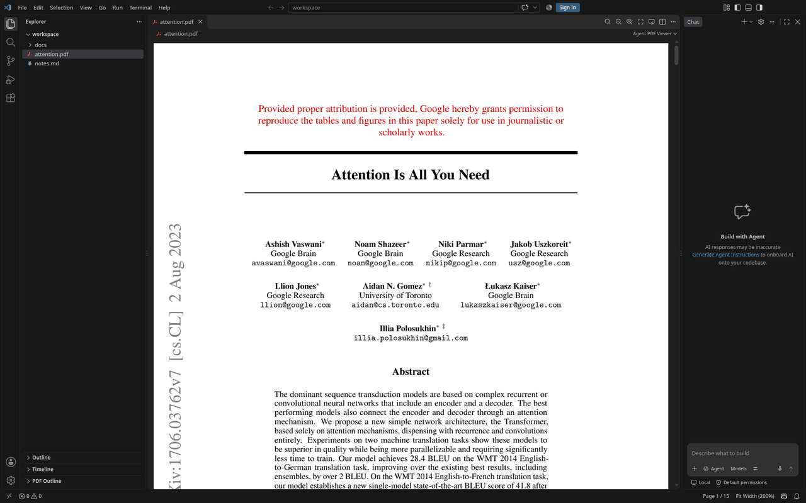
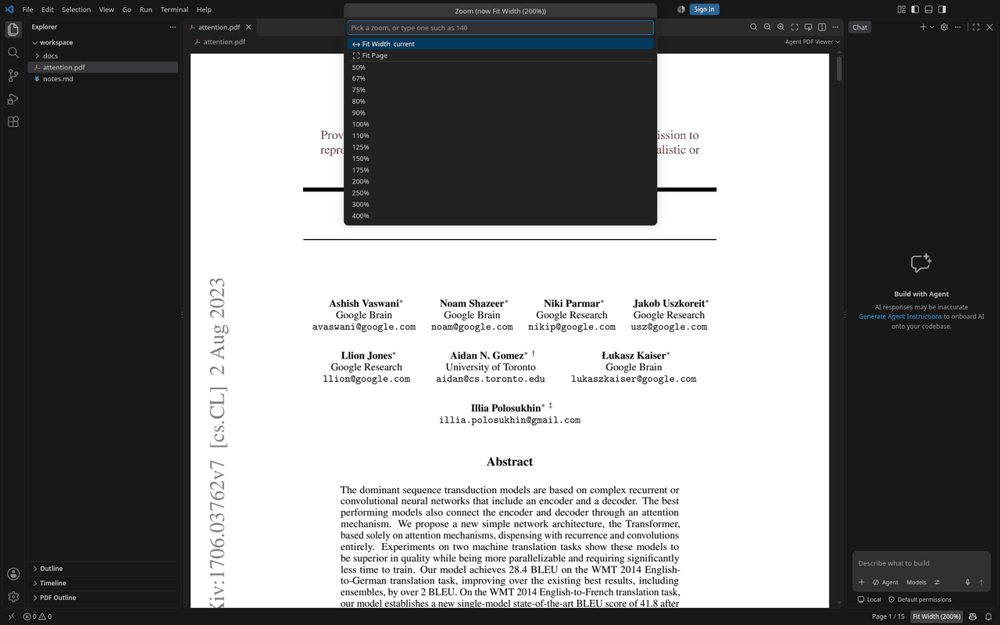
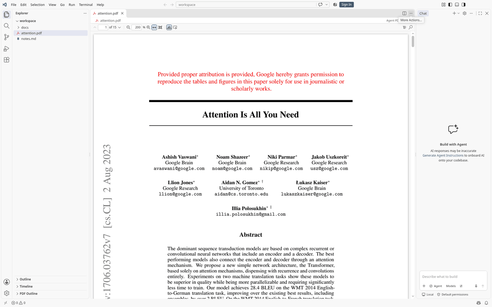
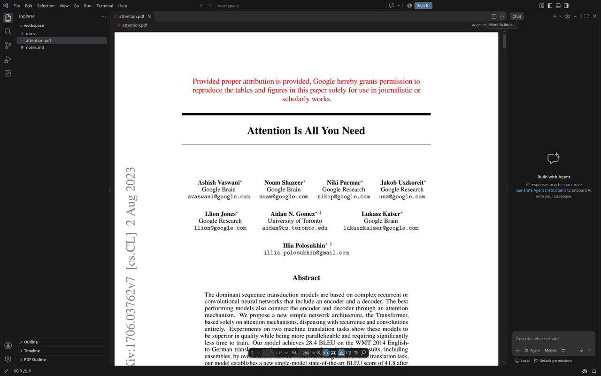
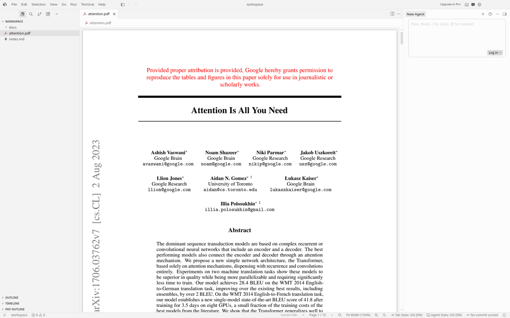

# Agent PDF Viewer (EmbedPDF)

[](https://github.com/t04dJ14n9/vscode-embedPDF/actions/workflows/ci.yml)

A PDF viewer for VS Code and Cursor, built on [EmbedPDF](https://www.embedpdf.com/)
and its PDFium engine. Select text or drag a box over a figure and press
**Copy Link for Agent**: the clipboard gets a link to the exact page and
box, the file's hash, the selected text, and for a box the path of a
snapshot of it, ready to paste into your agent. When the editor's own chat
is the only agent installed (or you pick one), that chat opens with it.

## Features

- **Viewer.** Continuous scrolling, page and zoom controls, fit width and fit
  page, Ctrl/⌘+wheel and pinch zoom, find in PDF (⌘F / Ctrl+F), internal links and web links.
  When the file changes on disk (a rebuilt paper), the viewer reloads at the
  same page and zoom.
- **Controls in VS Code's own UI.** By default the viewer has no toolbar of
  its own: find, zoom, fit and the selection tool are buttons in the editor
  title bar, and the page and zoom are in the status bar. Click **Page 4 / 15**
  to go to a page, or the zoom to pick one (or type one, such as `140`). See
  [Toolbar and shortcuts](#toolbar-and-shortcuts) for the other layouts.
- **Select Region tool.** Draws a region even over text (a paragraph with its
  equation, a table with its caption); Escape puts the tool down.
- **PDF Outline in the Explorer.** The PDF's bookmarks appear as a native
  tree view; click an entry to open its page.
- **Copy Link for Agent.** Select text, or drag over empty page
  space to select a region (a figure, table or equation), then use the
  button next to the selection, the right-click menu, the editor title
  button, or **PDF: Copy Link for Agent**. ⌘C / Ctrl+C (or **Copy text** next
  to a text selection) copies just the text. There is no separate Copy for
  Agent or Ask Agent: this one action always copies, and opens a chat only
  as described below.

  **Copy Link for Agent** copies the selection and, when it knows which agent you use,
  opens that agent's chat with it typed in, ready for your question:
  - in Cursor, a new agent chat, with a region's snapshot attached;
  - in VS Code, the chat view when a chat extension such as Copilot Chat is
    installed (and `chat.disableAIFeatures` is off), with the snapshot attached.

  Extensions cannot see which agent chat is focused, so this happens only when
  the editor's chat is the only agent installed. With Claude Code or Codex
  installed as well, Copy Link for Agent does not guess: it copies the selection (with
  the region snapshot's path) and asks you to paste it into your agent.

  The `vscodeEmbedPdf.copyLinkForAgent.target` setting sends it to one agent instead:
  `claudeCode` (a new Claude Code conversation with the selection typed in),
  `codex` (the selection and snapshot attached to the Codex thread), `cursor`,
  `chat`, or `clipboard`.

  In Cursor, the editor title bar keeps only a few buttons, so **Copy Link for Agent**
  sits in the **…** (More Actions) menu while something is selected. To pin
  it to the title bar, open that menu, choose **Configure Icon Visibility**
  and tick it.
- **Open Location.** **PDF: Open Location…** takes a link an agent printed and
  opens that page with the box highlighted.

## Toolbar and shortcuts



`vscodeEmbedPdf.toolbar.mode` sets where the controls are. **PDF: Choose
Toolbar Location…** (also in the editor's **…** menu) switches it, and every
open PDF follows at once.

| Mode | Controls |
| --- | --- |
| `chrome` (default) | Editor title buttons (find, zoom out and in, fit page or width, Select Region / Select Text) and status bar entries: the page and the zoom, which open Go to Page and a zoom picker. |
| `slim` | A slim bar along the top of the viewer, with every control. |
| `floating` | A bar over the pages, docked to the middle of an edge. Drag its grip to another edge, or focus the grip and press an arrow key; the edge is remembered for every PDF. It fades while the pointer rests. |
| `none` | No controls: keyboard shortcuts, the right-click menu, the **…** menu and the command palette. |

| Zoom picker (`chrome`) | Slim bar, light theme | Floating bar |
| --- | --- | --- |
|  |  |  |

Every action is also a **PDF:** command with a shortcut, active while a PDF
editor has focus (not in a text field, the side bar or the panel):

| Action | Windows / Linux | macOS |
| --- | --- | --- |
| Previous / next page | Alt+PageUp / Alt+PageDown | ⌥PageUp / ⌥PageDown |
| Go to page… | Ctrl+G | ⌃G |
| Zoom in / out | Ctrl+= / Ctrl+- | ⌘= / ⌘- |
| Pick a zoom… | click the status bar zoom | |
| Fit width | Ctrl+0 | ⌘0 |
| Fit page | Ctrl+Alt+0 | ⌥⌘0 |
| Find in PDF | Ctrl+F | ⌘F |
| Toggle the PDF Outline | Ctrl+Alt+O | ⌃⌘O |
| Select Text tool | Ctrl+Alt+T | ⌃⌘T |
| Select Region tool | Ctrl+Alt+R | ⌃⌘R |

While a PDF has focus, these take over the editor-wide meanings of the same
keys (Ctrl+G is Go to Line elsewhere, Ctrl+0 focuses the side bar). Some
desktops keep Ctrl+Alt+T for opening a terminal; rebind it in **Keyboard
Shortcuts** if so.

**In Cursor**, the editor title bar keeps extension buttons in its **…**
menu, so the viewer leaves its title buttons out (the menu lists every
action, grouped) and the status bar also shows previous and next page, zoom
out and in, and find buttons. `vscodeEmbedPdf.toolbar.statusBarButtons`
(`auto`, `always`, `never`) changes that, in either editor.



## What an agent receives

```text
Source: [papers/attention.pdf (page 3)](<papers/attention.pdf#page=3&viewrect=72,83,134,21>)
PDF source SHA-256: `9f86d081884c7d659a2feaa0c55ad015a3bf4f1b2b0b822cd15d6c15b0f00a08`

Selected text:
Scaled dot-product attention

When you answer, cite the Source link above so the reader can reopen this spot in the PDF.
```

The last line is there because agents rarely cite the link unprompted; with
it they do, and **PDF: Open Location** opens what they cite.

For a region, the lines after the hash ask the agent to read or render the area inside
the box, give the path of a PNG snapshot of it, and list the text inside it
line by line (so a table reads row by row):

```text
Selected PDF region. Read the text inside the view rectangle, or render that area of the page to inspect figures and tables.
Region image: `/…/workspaceStorage/…/regions/attention-p9-3f2a….png`

Text in the region, line by line (table columns are not kept; see the image):
Table 3: Variations on the Transformer architecture. …
base 6 512 2048 8 64 64 0.1 0.1 100K 4.92 25.8 65
…
big 6 1024 4096 16 0.3 300K 4.33 26.4 213
```

Snapshots are saved in a `regions` folder in the extension's storage for the
workspace (`workspaceStorage/<id>/t04dj14n9.vscode-embedpdf/regions`), not in
the workspace itself (global storage when no folder is open). Together they
use at most `vscodeEmbedPdf.regionImageCache.maxSizeMB` megabytes (default 100,
at least 1; a change applies from the next snapshot): past that, the least
recently used are deleted, never the one just saved. Copying or asking about a
region again counts as a use. A selection across pages lists one link per
page.

The location uses the `page` and `viewrect` parameters of
[RFC 8118](https://www.rfc-editor.org/rfc/rfc8118): `viewrect=left,top,width,height`
in PDF points (1/72 inch), measured from the page's top-left corner. Paths are
relative to the workspace folder, or absolute for files outside it.

## Agent bridge (MCP, experimental, off by default)

Instead of pasting, an agent can ask the viewer for what you have selected.
Turn on `vscodeEmbedPdf.agentBridge.enabled` (or run **PDF: Copy MCP Setup
for Claude Code / Codex…**, which offers to) and the extension starts a local
[MCP](https://modelcontextprotocol.io/) server with these tools:

| Tool | What it does |
| --- | --- |
| `get_current_pdf_selection` | The text or region selected in the PDF you last looked at: the same text Copy Link for Agent copies, and for a region its PNG snapshot. |
| `open_pdf_location` | Opens a `path#page=N&viewrect=…` link in the viewer. |
| `get_current_note_selection` | The selection in Markdown Workbench, when it is installed. |

The server is off by default because it opens a port. When on, it listens on
`127.0.0.1` only, on a random port, requires a random bearer token, and
refuses requests that carry a browser `Origin`. Turning the setting off stops
it at once; no reload is needed.

- **VS Code** (chat agent mode) and **Cursor** find it by themselves.
- **Claude Code** and **Codex** connect through a small stdio shim: **PDF: Copy
  MCP Setup for Claude Code / Codex…** copies the `claude mcp add …` or
  `codex mcp add …` command (or a config snippet) to run once. The shim picks
  the window whose workspace contains the agent's folder, from the files each
  running bridge writes to `~/.agent-pdf-viewer/bridges/`.

This is a prototype: the Cursor registration uses an undocumented API, and
only the on/off switch has an end-to-end test.

## Opening a location from another extension

```ts
await vscode.commands.executeCommand(
  'vscodeEmbedPdf.openLocation',
  vscode.Uri.file('/path/to/paper.pdf'),
  { page: 3, viewRect: { left: 72, top: 83, width: 134, height: 21 } },
);
```

The command also accepts a link string such as
`papers/paper.pdf#page=3&viewrect=72,83,134,21`.

## With LLM Wiki installed

LLM Wiki for VS Code ships its own PDF viewer for now. Both register as the
default editor for `*.pdf`, so VS Code asks which one to use; pick one with
**Reopen Editor With…** or the `workbench.editorAssociations` setting.

## How it is built

```text
src/
├── shared/      used on both sides; no DOM, no VS Code, no Node
│   ├── messages.ts       every message between extension and viewer, validated
│   ├── selection.ts      text and region selections
│   ├── pdf-location.ts   page + viewrect links (RFC 8118)
│   ├── agent-text.ts     the text Copy Link for Agent hands over
│   ├── agent-target.ts   which agent chat Copy Link for Agent opens
│   ├── note-reference.ts the @note#lines reference the agent bridge returns
│   ├── region-text.ts    the text inside a region, line by line
│   ├── zoom-steps.ts     the zoom levels the buttons and wheel step through
│   ├── view-state.ts     page and zoom reported by the viewer; view actions
│   ├── toolbar-settings.ts  toolbar modes and the floating bar's edge
│   └── geometry.ts       page rectangles
├── bridge-stdio/  the stdio shim Claude Code and Codex run to reach the bridge
├── extension/   the VS Code side
│   ├── extension.ts            activation
│   ├── pdf-editor-provider.ts  opens *.pdf files
│   ├── pdf-panel.ts            one open editor: loads the file, reloads on change
│   ├── pdf-panels.ts           all open editors and the active one
│   ├── region-images.ts        region snapshots saved for agents
│   ├── outline-view.ts         the PDF Outline tree
│   ├── commands.ts             Copy Link for Agent, Open Location
│   ├── view-commands.ts        page, zoom, find and tool commands; Go to Page, zoom picker
│   ├── toolbar.ts              the toolbar setting, status bar entries
│   ├── agent-chat.ts           opening the agent chat with a selection
│   ├── agent-bridge/           the opt-in MCP server and its tools
│   └── webview-html.ts         the viewer page and its content security policy
└── webview/     the viewer (React + EmbedPDF), one module per concern
    ├── main.tsx, host.ts       entry and messages to the extension
    ├── engine.tsx, plugins.ts  PDFium in a worker (main-thread fallback)
    ├── viewer.tsx              toolbar, search, pages
    ├── toolbar.tsx             the slim bar's controls
    ├── floating-toolbar.tsx    the floating bar: docking, dragging, fading
    ├── view-sync.ts            page and zoom to the extension, its actions back
    ├── tool-mode.ts            the Select Text and Select Region tools
    ├── page.tsx, page-links.tsx
    ├── navigation.ts           pages, locations, highlights
    ├── reading-position.ts     the place and zoom kept across reloads
    ├── wheel-zoom.ts           Ctrl/⌘+wheel zoom, one step per notch
    ├── selection.ts            reporting text and region selections
    ├── region-details.ts       a region's text and PNG snapshot
    ├── drag-release.ts         ending drags released outside the viewer
    ├── secondary-buttons.ts    right-clicks left to the context menu
    └── styles/                 CSS using VS Code theme colours
```

The viewer renders untrusted PDF content, so the extension accepts only
well-formed messages from it (`shared/messages.ts`), opens only web and mail
links, and loads scripts only from the extension. The viewer never makes
network requests.

## Development

```sh
pnpm install
pnpm build            # dist/extension.js and dist/webview/
pnpm check            # lint, typecheck, unit tests
pnpm test:browser     # the viewer in Chromium, with a stand-in for VS Code
pnpm test:vscode      # the packaged extension in a real VS Code window
pnpm package          # production build and .vsix
```

`test:vscode` downloads VS Code into `.vscode-test/`, installs the extension
into a throwaway profile and home folder under `/tmp`, and drives the window
with Playwright. It never touches your own VS Code settings or extensions. Set
`VSCODE_EXECUTABLE` to test another build, or Cursor (its `cursor` executable,
for example `…/usr/share/cursor/cursor` in an extracted AppImage). On Linux
without a display, run it under `xvfb-run -a`.

Test PDFs are generated by `test/fixtures/make-fixtures.mjs`, so every
coordinate in the tests is known.

## CI and quality gates

[`.github/workflows/ci.yml`](.github/workflows/ci.yml) runs on every pull
request and on pushes to `main`. Each job, and how to run it locally:

| Job | What it proves | Locally |
| --- | --- | --- |
| `check` | Lint, typecheck and unit tests pass | `pnpm check` |
| `browser` | The webview suite in Chromium; on failure, `test-results/` is uploaded | `pnpm test:browser` |
| `vscode (VS Code stable)` | The packaged extension in the latest VS Code stable, under `xvfb-run` | `xvfb-run -a pnpm test:vscode` |
| `package` | `pnpm package` builds the VSIX, leaves committed files unchanged, and the VSIX is under 8 MB with no tests, sources, source maps or secret-shaped strings; the VSIX is uploaded as the `vsix` artifact | `pnpm package && bash .github/scripts/check-vsix.sh *.vsix 8` |
| `secret-scan` | gitleaks finds no secrets in the git history | `gitleaks git --redact .` |
| `audit (advisory)` | `pnpm audit --prod`; a warning, never a failure | `pnpm audit --prod` |

Cursor cannot run in CI, so test it by hand with
`VSCODE_EXECUTABLE=<cursor executable> xvfb-run -a pnpm test:vscode`. CI never
uses API keys or other secrets. Dependabot proposes grouped npm and
GitHub Actions updates weekly.

Pushing a tag `v<version>` that matches `package.json` runs
[`release.yml`](.github/workflows/release.yml): `pnpm check`, `pnpm package`,
and a GitHub Release with the VSIX attached. Publishing stays manual: with a
Marketplace PAT run `pnpm exec vsce publish --packagePath <file>.vsix`, and
for Open VSX `pnpm dlx ovsx publish <file>.vsix -p <token>`. Do not store
these tokens in the repository.

## License

MIT. Third-party licenses (EmbedPDF, PDFium, React) are in
[THIRD_PARTY_NOTICES.md](THIRD_PARTY_NOTICES.md).
