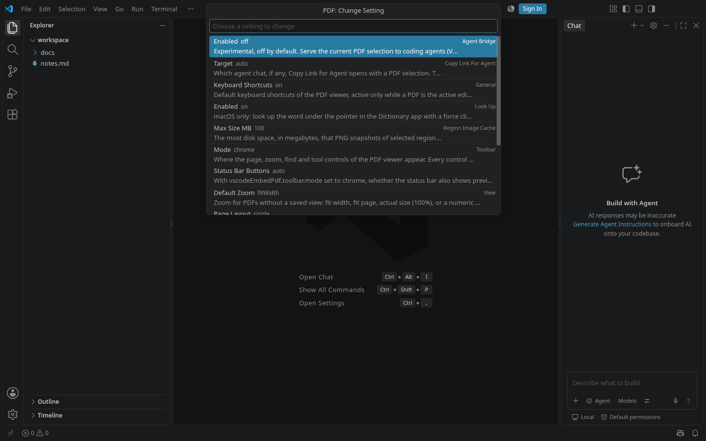

# Settings from the Command Palette

Every setting of this extension can be changed without opening a settings file.

| Command | What it does |
|---|---|
| **PDF: Open Settings** | Opens VS Code's Settings editor filtered to this extension (`@ext:t04dj14n9.vscode-pdf-workshop`). Also in the viewer's right-click menu and as **Settings…** in the **View…** picker. |
| **PDF: Change Setting…** | Lists *all* of the extension's settings, grouped, with the current value and the description; picking one edits it by its type (below). |
| **PDF: Toggle Smooth Scrolling** | Flips `view.smoothScrolling` (from what is in effect now, also when it followed the editor). |
| **PDF: Toggle Keyboard Shortcuts** | Flips `keyboardShortcuts`. |
| **PDF: Choose Toolbar Location…** | `toolbar.mode`. |
| **PDF: Set Default Zoom… / Page Layout… / Scrolling…** | `view.defaultZoom`, `view.pageLayout`, `view.scrollMode`. |

## How PDF: Change Setting… edits

The list is generated from the extension's `package.json` (`contributes.configuration`), so a new setting appears in it
without code and it cannot drift from the Settings editor.

- **true/false**: toggles at once.
- **true/false/null** (smooth scrolling): On, Off, or *Follow the editor*.
- **a list of values**: a pick list with each value's description.
- **a number**: an input box that checks the manifest's minimum and maximum.
- **text**: an input box.
- **anything else** (the default zoom, which is a keyword or a percentage): opens the Settings editor on that setting;
  **PDF: Set Default Zoom…** edits it.

## Same settings, no separate state

The commands read and write exactly the keys the Settings editor shows, and keep nothing of their own, so the two
always agree and open viewers follow the change as for any edit in the Settings editor. A command writes to the
**workspace** settings when the workspace already sets that key (a user-level value would be hidden behind it), and
to the **user** settings otherwise.
