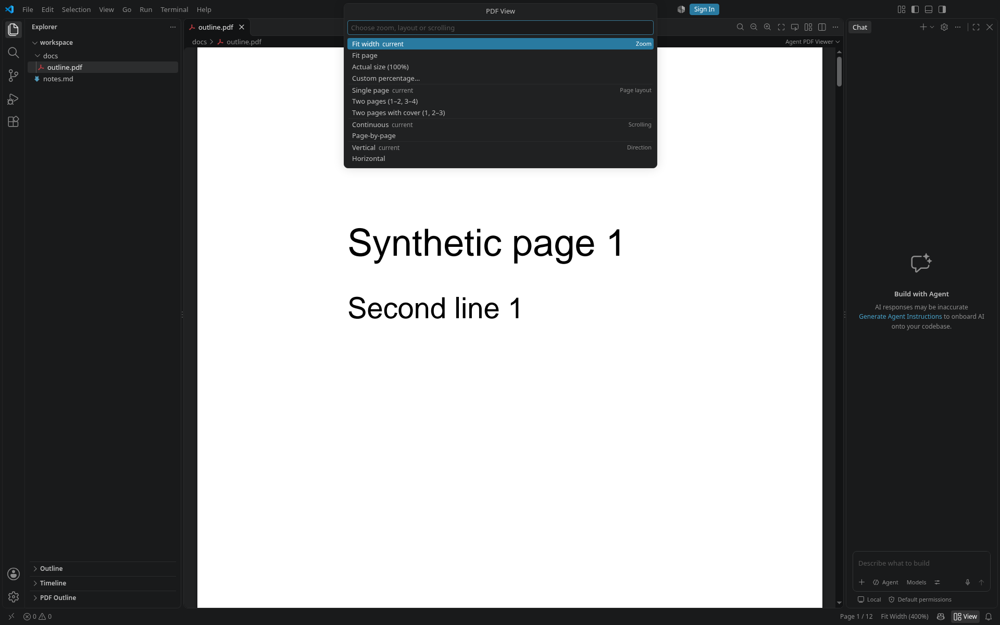
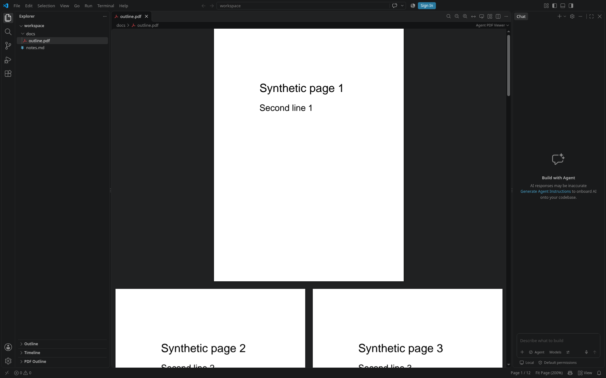
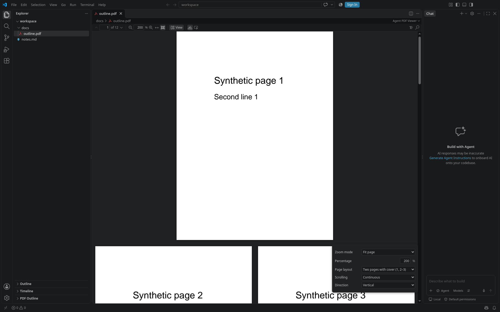

# PDF view controls

Single-page and two-page layouts use `@embedpdf/plugin-spread@2.15.1`.
`SpreadMode.None` displays individual pages; `SpreadMode.Odd` pairs 1–2,
3–4; `SpreadMode.Even` leaves the cover alone and pairs 2–3, 4–5. Both
spread layouts support vertical and horizontal reading, continuous and
page-by-page scrolling, page jumps, fit modes and saved views.

## Investigation and implementation decisions

Inspected the installed EmbedPDF **2.15.1** declarations and implementation
before implementing these controls, together with `toolbar.tsx`,
`floating-toolbar.tsx`, `plugins.ts`, `navigation.ts`, and `reading-position.ts`.

| Area           | Existing support                                                                                                                                                                                                                 | Decision                                                                                                                                                                                                                                                                              |
| -------------- | -------------------------------------------------------------------------------------------------------------------------------------------------------------------------------------------------------------------------------- | ------------------------------------------------------------------------------------------------------------------------------------------------------------------------------------------------------------------------------------------------------------------------------------- |
| Toolbar        | Slim and floating share `ToolbarControls`. Chrome uses commands, editor title actions and page/zoom status entries. There is also a hidden `none` mode.                                                                          | Add a compact View group to the shared controls and a View picker in chrome's status bar/title actions. Keep slim's existing location and floating's docking.                                                                                                                         |
| Zoom           | `ZoomScope.requestZoom` accepts `ZoomMode.FitWidth`, `ZoomMode.FitPage`, or a numeric scale. Fit calculation already measures whole spreads.                                                                                     | Reuse it for every zoom choice. Actual size is numeric scale **1**; custom percentages keep the existing 25–400% range.                                                                                                                                                               |
| Spreads        | The installed spread plugin exports `SpreadPluginPackage`, `SpreadMode` and document-scoped capabilities through its React entrypoint. Scroll and zoom consume its grouped page geometry and change events. | Register it before scroll and zoom, with the saved layout as `defaultSpreadMode`. Map `single` to `None`, `spread` to `Odd`, and `spreadCover` to `Even`; apply changes with `SpreadScope.setSpreadMode`. |
| Direction      | `ScrollScope.setScrollStrategy` supports vertical and horizontal. Native next/previous operations navigate virtual items, which are pages or spreads.                                                                            | Reuse the strategies and layout for both directions and spread stepping.                                                                                                                                                                                                              |
| Page-by-page   | Scroll has no non-continuous strategy or component.                                                                                                                                                                              | Keep the native Scroller/Viewport and their coordinates; render only the selected native layout item and constrain panning to it. Next/previous and page links select another item. Hide the document-length scrollbar in this mode; wheel/trackpad/keyboard still pan a zoomed page. |
| Page jumps     | `scrollToPage` accepts `behavior: 'smooth'`; Viewport forwards it to browser scrolling. Current navigation forces `instant`.                                                                                                     | Use native smooth jumps when enabled. Restoration remains instant. Page-by-page changes use a brief reveal transition, since intervening pages are not displayed.                                                                                                                     |
| Wheel          | Native browser scrolling preserves trackpad deltas. The existing Ctrl/⌘ wheel handler already provides stepped zoom.                                                                                                             | Animate only recognisable large discrete wheel steps, with a short cancellable animation. Preserve other pixel deltas. Wheel devices do not identify themselves: integral 100/120-pixel notches are a conservative heuristic.                                                         |
| Zoom animation | Zoom emits old/new scales and the focus point, but has no animation option.                                                                                                                                                      | Animate the displayed native scroller briefly from its old scale to the new one, leaving fit modes and final coordinates to EmbedPDF. Cancel on interaction or a new transition.                                                                                                      |
| Persistence    | Reading position and zoom survive a file rebuild in a module outside React; closing/reopening has no durable view persistence. Panels are individually tracked.                                                                  | Extend reading position to include layout/modes and offsets. Retain it across rebuilds and save the last validated report on panel disposal in extension storage for reopen. Open panels keep independent state.                                                                      |

## Controls

The viewport centers content using native layout sizes, matching EmbedPDF's
zoom focus calculation. Page-by-page mode adds end padding so the last page
can reach the same position as earlier pages. During the brief visual zoom
transition, a press settles the display before a new page drag starts, keeping
selection coordinates tied to the native final scale.

**View** exposes zoom mode, page layout, scrolling mode and direction in slim
and floating toolbars, and through a status bar picker and editor action in
chrome. All choices are also available as PDF commands and in the PDF context
menu, including when the toolbar is hidden.

- **Fit width** fits the document's widest page or spread; **Fit page**
  fits the document's largest page/spread dimensions. **Actual size** selects 100%. Type a custom
  percentage in the existing zoom field or zoom picker.
- **Single page** (`single`, native `none`) displays individual pages.
  **Two pages** (`spread`, native `odd`) pairs 1–2, 3–4.
  **Two pages with cover** (`spreadCover`, native `even`) displays page 1
  alone, then 2–3, 4–5. An unpaired final page appears alone.
  Next/previous moves to the adjacent spread; go to page opens the containing
  spread. Box, outline and internal-link destinations retain their page coordinates.
  Changing pairing or direction keeps the current page in view.
- **Continuous** scrolls through the document. **Page-by-page** displays one
  page or spread at a time; use next/previous or go to page to change it.
  At larger zooms, pan within that page/spread with wheel, trackpad or keys.
- **Vertical** and **Horizontal** choose the continuous reading direction.
- Smooth motion applies to discrete wheel scrolling, page/outline/internal
  link jumps and displayed zoom changes. Native trackpad scrolling is retained.
  Motion is always disabled with `prefers-reduced-motion: reduce`.

## Settings

Defaults apply to PDFs without a saved view. Reopening restores the saved
page, offsets, zoom, layout, scrolling mode and direction. File rebuilds keep
the current panel's view. Changing the page-layout setting updates open PDF
panels; commands and toolbar choices target their own panel. Other default
settings apply on a new view, while smooth-scrolling changes apply immediately.
An unrelated settings update preserves a panel's chosen or saved layout.

| Setting                               | Values / default                                                                                           |
| ------------------------------------- | ---------------------------------------------------------------------------------------------------------- |
| `pdfWorkshop.view.defaultZoom`     | `fitWidth` (default), `fitPage`, `actual`, or a numeric percentage (25–400)                                |
| `pdfWorkshop.view.pageLayout`      | `single` (default, native `none`), `spread` (native `odd`), `spreadCover` (native `even`)                     |
| `pdfWorkshop.view.scrollMode`      | `continuous` (default), `paged`                                                                            |
| `pdfWorkshop.view.scrollDirection` | `vertical` (default), `horizontal`                                                                         |
| `pdfWorkshop.view.restoreOnReopen` | `true` (default): reopen a PDF at its last page, scroll position, zoom and view choices; `false`: always start from the defaults |
| `pdfWorkshop.view.smoothScrolling` | `null` (default: follows `editor.smoothScrolling`), `true`, `false`; reduced motion overrides all settings |

## Commands

Command ids use the `pdfWorkshop.` prefix. Existing `fitWidth`, `fitPage`,
`zoomIn`, `zoomOut`, `selectZoom`, `goToPage`, `nextPage`, and `previousPage`
remain the controls for zoom and navigation. New view choices use
`actualSize`, `selectView`, `singlePage`, `twoPageSpread`, `twoPageCover`,
`continuousScroll`, `pageByPage`, `verticalScroll`, and
`horizontalScroll`. Each command targets the active PDF panel.

## Verification

Unit coverage exercises native spread mapping and registration order, settings, view/action validation, saved positions,
wheel animation arithmetic and reduced-motion resolution. Additional unit
coverage verifies independent same-file panels and exact saved zoom/offsets.
Browser specs cover controls, native spread pairing in both directions, spread
navigation and fit modes, panning bounds, motion and restoration; one VS Code
spec covers spread commands and reopening.

Run lint, typechecking, the build and unit tests locally. Browser and real-editor
specs require Chromium/VS Code and permission to open local listening sockets;
they cannot run in sandboxes that deny those sockets. The real-editor specs
(`pnpm test:vscode`) do not run in CI; run them locally before every push
(`xvfb-run -a pnpm check:full` on headless Linux).

## Screenshots (real VS Code)

Chrome mode: the status bar's **View** entry opens the picker.

Two pages with cover (page 1 alone, then 2–3), fit page:

Slim bar: the **View** menu next to the zoom controls (floating bar: the same menu).

