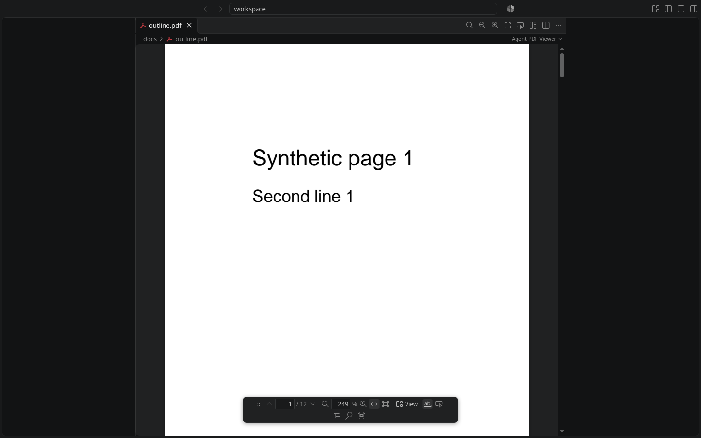

# Zen mode

**PDF: Enter Zen Mode** (`Ctrl+Alt+Z`, `Ctrl+Cmd+Z` on macOS, or *Zen Mode* in the viewer's right-click menu) reads
the PDF with nothing else on screen. It is VS Code's own Zen Mode, with the part a PDF needs added.

## What it does

- VS Code's **Zen Mode** hides the side bar, panels and status bar and goes full screen, using your `zenMode.*`
  settings, and puts everything back when it ends. The extension does not close or reopen anything itself.
- The status bar is hidden in zen, so PDF controls are **command palette / keyboard only** until zen ends.
  Slim and floating viewer bars were removed; `lumiere.pdf.toolbar.mode` is never changed for zen.
- **Exit**: `Ctrl+Alt+Z` again (`Ctrl+Cmd+Z`), **PDF: Exit Zen Mode**, or VS Code's own `Ctrl+K Z`.

All of the PDF shortcuts are turned off by `lumiere.pdf.keyboardShortcuts`, these too.

## Settings that matter

- `zenMode.centerLayout` (VS Code's, default on) centres the editor and leaves wide margins, so the PDF is narrower
  than the screen. Turn it off to read edge to edge: `"zenMode.centerLayout": false`. The extension does not change
  it for you, because that would be a global setting changed behind your back.
- `zenMode.fullScreen`, `zenMode.hideStatusBar`, `zenMode.showTabs` as you like them.

## Limits

- VS Code has no API to ask whether zen is on. The extension uses two commands chosen by the `inZenMode` context key,
  and the viewer watches the window: when a full-screen zen ends some other way (`Ctrl+K Z`, the Command Palette),
  it clears its zen flag by itself.
- A web page inside VS Code cannot go full screen itself (VS Code does not allow it), which is why the extension
  builds on Zen Mode instead.
- **Not verified on macOS or in Cursor.** Tested in VS Code 1.141 on Linux. Check `Ctrl+Cmd+Z` on a Mac. Cursor
  has its own panes in zen; they were not tried.
